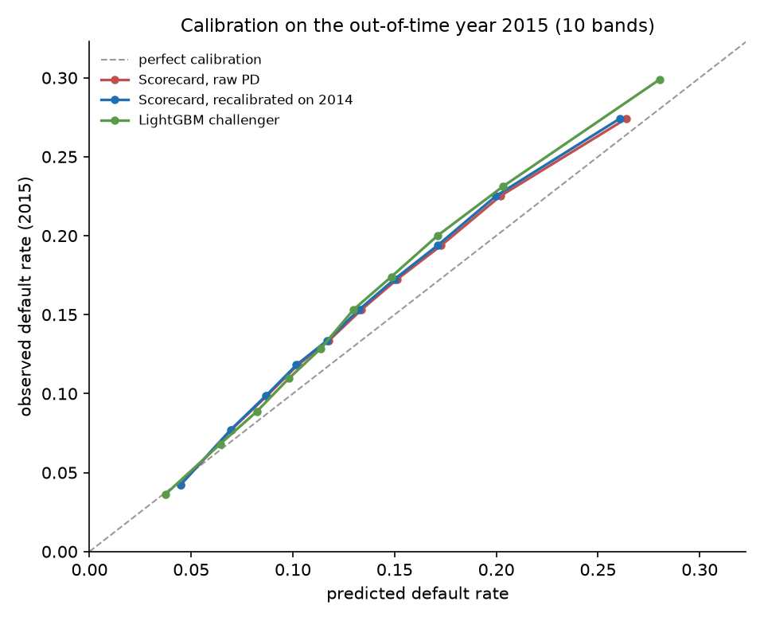
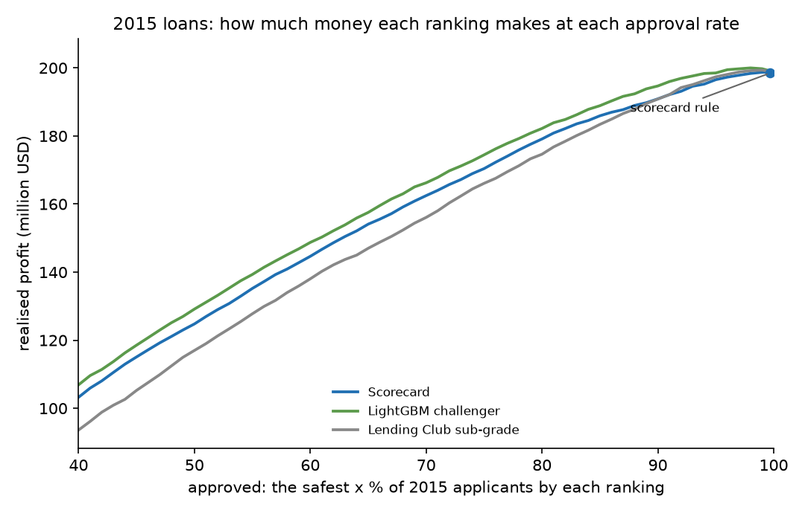
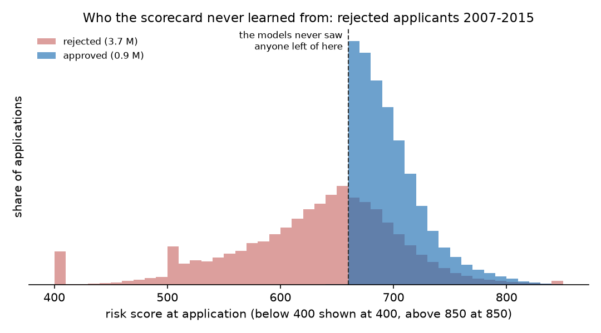
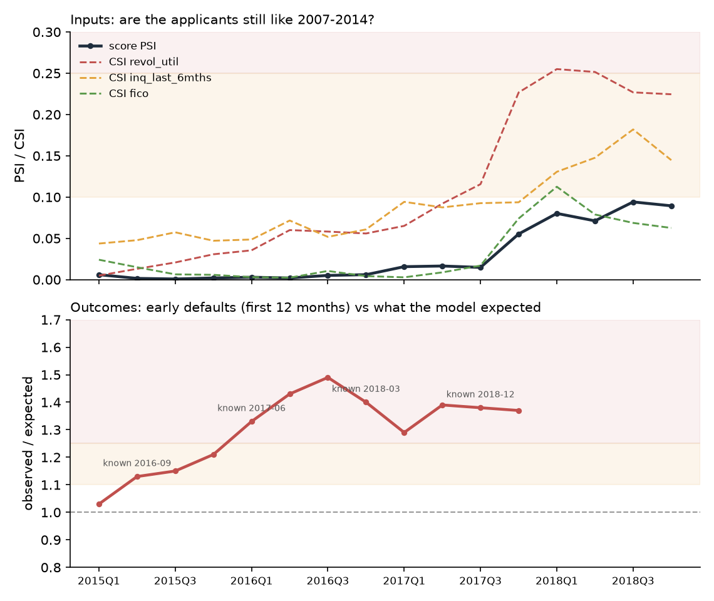
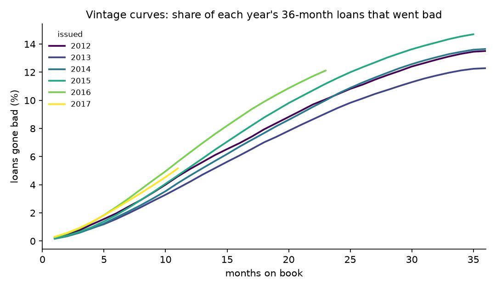

# Credit-risk scorecard

A loan scorecard built the way a bank would build it: from raw loans to an approve/decline rule with reasons,
validated on later loans than it was trained on. Data: 2.26 M Lending Club loans, 2007–2018.
Status: v0.3, milestones 3.0–3.6 done. **Try it: [omercan4.github.io/credit-risk-scorecard](https://omercan4.github.io/credit-risk-scorecard/)**: fill in an application and watch the points add up.

**Results on 283,026 loans from 2015, a year never used for any choice:**
- A 9-characteristic points scorecard ranks risk with **Gini 0.30**, and a LightGBM challenger reaches **0.34**. Lending Club's own grade, built with the full credit report, reaches 0.36. Both models beat that grade until 2012, and it pulled ahead as Lending Club improved it.
- **Every decline comes with its top 3 reasons,** read straight from the points table. An example: *FICO below 665 (−37 points), 3+ inquiries in 6 months (−17), income below 27,300 (−14).*
- **All models under-predict 2015 defaults** (13.5 % vs 14.9 %), because 2015 was riskier than any training year. The ranking holds, but the level drifted.
- **Money:** at Lending Club's prices, almost every approved loan was worth funding, so a profit rule declines under 1 %. The scorecard is worth money when choosing *which* loans to fund. An investor funding half of the 2015 loans by the scorecard earns 6.29 % on money lent, against 6.09 % when picking Lending Club's best grades. The challenger earns 6.60 %.
- **What the models never saw:** 63 % of the rejected applicants had a risk score below 660, which no approved loan had.
- **Monitoring after go-live caught a drift that the input checks missed.** Applicants in 2015–2016 looked as safe as in development (score PSI ≤ 0.006), but early defaults ran up to **1.49×** what the model expected. The red light would have been visible from June 2017.

Not for real lending decisions.

## The task

> At the moment of application, estimate the probability that a 36-month loan will default (charged off) within its term,
> using only what is known at application time. Turn it into a score, an approve/decline rule chosen by expected profit,
> and the top reasons for each decline.

About half the columns in the Lending Club data are only filled in after the loan was paid out (payments, recoveries,
the last FICO score). A model that uses them looks almost perfect and is useless. Every column therefore belongs to one
group in [`src/crs/config.py`](src/crs/config.py), and only the application-time group can become a model feature.
Lending Club's own `grade` and `int_rate` are the benchmark to beat, not inputs.

## Validation design

- Development years 2007–2014, with expanding-window time cross-validation (train up to year *t*, test on *t+1*).
- One out-of-time test on 2015, which nothing was tuned on.
- 2016–2018 applications simulate the time after go-live for monitoring.

There is no random k-fold, because credit policy, prices and the economy changed over these years. Random folds would let later
loans leak into training and overstate how well the model works on next year's applicants.

There is one caveat: the clock is the issue date. In practice a 2010 loan's outcome is only known around 2013, so a bank would
wait longer before training on it. The split is honest about the applicants, but slightly optimistic about how fast outcomes arrive.

## Population

2,260,668 loans, all data checks passed. The modelling population is the 36-month loans issued 2007–2015 that reached a final status:

| | loans |
|---|---:|
| in the population | 621,022 |
| 60-month term (left out) | 650,914 |
| issued 2016–2018, term not over (monitoring only) | 988,585 |
| 2007–2015, still open or late at the end of the data | 147 |

Bad = "Charged Off" or "Default". The 2,438 old loans marked "does not meet the credit policy" stay in, with their real outcome.

| issue year | loans | default rate |
|---|---:|---:|
| 2007 | 603 | 26.2 % |
| 2008 | 2,393 | 20.7 % |
| 2009 | 5,281 | 13.7 % |
| 2010 | 9,156 | 10.9 % |
| 2011 | 14,101 | 10.6 % |
| 2012 | 43,470 | 13.6 % |
| 2013 | 100,422 | 12.3 % |
| 2014 | 162,570 | 13.7 % |
| **2015 (out-of-time test)** | **283,026** | **14.9 %** |

Two things to note:
- Defaults were high in 2007–08 (the financial crisis, and a young platform), then rose again from 2013 as Lending Club grew fast.
- The test year 2015 is riskier than the development years (14.9 % vs 13.2 %). A model calibrated on the past will under-predict defaults there unless it is recalibrated, and the validation has to show this, not hide it.

## The scorecard

Nine characteristics, chosen by information value and time cross-validation (full tables: [`reports/scorecard.md`](reports/scorecard.md),
the scorecard itself: [`models/scorecard.json`](models/scorecard.json)):
FICO score, annual income, debt-to-income ratio, loan amount / income, number of mortgage accounts, home ownership,
credit inquiries in the last 6 months, revolving utilisation and loan purpose.

| test year (trained on all earlier years) | 2011 | 2012 | 2013 | 2014 | mean |
|---|---:|---:|---:|---:|---:|
| Gini, up to 6 characteristics | 0.323 | 0.278 | 0.276 | 0.275 | 0.288 |
| **Gini, up to 9 (chosen)** | 0.342 | 0.292 | 0.273 | 0.292 | **0.300** |
| Gini, up to 12 | 0.341 | 0.293 | 0.277 | 0.296 | 0.302 |

How it was built:
- **WoE binning** with the default-rate trend forced where it is a business rule (a higher FICO score or income never looks riskier, a higher debt ratio never looks safer). Every bin holds at least 5 % of the loans.
- **Selection:** strongest characteristics first, skipping any whose WoE correlates above 0.6 with one already chosen. Every coefficient must be negative, the right sign with WoE inputs. The largest VIF is 1.6.
- **Points:** 600 points = odds of 50 goods to 1 bad, and 20 points double the odds. The score is the sum of the points in the table, so anyone can add it up by hand.
- **Decline reasons:** the characteristics where an applicant lost the most points against the best bin. Example, a 2015 applicant scoring 490: *FICO score below 665 (−37), 3 or more credit inquiries in 6 months (−17), income below 27,300 (−14).*

What did not help, and decisions I made:
- **Up to 12 characteristics gives +0.002 Gini,** which is noise, so the smaller scorecard stays.
- **The signal is modest (IV of FICO is 0.14)** because these are approved loans only: Lending Club had already screened out the riskiest applicants (FICO below 660 and others), so the remaining differences are small. This is the reject-bias problem (milestone 3.4).
- **Income verification is left out,** although it is known at application time. Lending Club verified mostly the applicants it already found risky, so "verified" looks riskier. That is its own judgement leaking in, and it is not a fair decline reason.
- **A missing value never earns points:** a missing bin with fewer than 1 % of loans gets the points of the riskiest bin. Without this rule, the 29 applicants without an inquiry count got the top score for that characteristic by chance.
- **The number of mortgage accounts was only recorded from 2012 on.** Its missing bin therefore mostly stands for "older loan", and it is never used for new applicants.

## Out-of-time test: 2015

283,026 loans issued in 2015 that were never used for any choice. Full report: [`reports/validation.md`](reports/validation.md).

| | Gini | KS | Brier | mean predicted PD (observed: 14.9 %) |
|---|---:|---:|---:|---:|
| Lending Club sub-grade (benchmark) | **0.357** | 0.262 | 0.121 | 12.8 % |
| LightGBM challenger (monotone constraints) | 0.343 | 0.249 | 0.121 | 13.3 % |
| Scorecard | 0.303 | 0.218 | 0.122 | 13.5 % |

Differences with 95 % bootstrap intervals: challenger − scorecard **+0.040** (0.037 to 0.042), scorecard − sub-grade −0.054 (−0.059 to −0.049).

**The result I hoped for did not happen: neither model beats Lending Club's own grade in 2015.** The same comparison on every test year shows why:

| test year | scorecard | challenger | Lending Club sub-grade |
|---|---:|---:|---:|
| 2011 | 0.342 | 0.359 | 0.270 |
| 2012 | 0.292 | 0.296 | 0.239 |
| 2013 | 0.273 | 0.307 | 0.298 |
| 2014 | 0.292 | 0.324 | 0.319 |
| 2015 | 0.303 | 0.343 | 0.357 |

Both models beat the grade until 2012. But Lending Club's grade improved every year (0.24 → 0.36), while these models see only 22 application fields. Lending Club priced loans with the full credit report and its own platform data.
The fair claim is therefore: *with application data alone, a challenger comes within 0.014 Gini of the lender's production grade.*



**Calibration:** all three models predict too few defaults in 2015 (13.3–13.5 % predicted vs 14.9 % observed), in every band, because 2015 was a riskier year than any development year.
Recalibrating on 2014 changes almost nothing, since 2014 itself was safer than 2015. The ranking holds, but the level moved.
In real use this is caught by monitoring (milestone 3.5): the default level is checked as outcomes arrive, and the PD is shifted when it drifts.

**Champion or challenger?**
- **The challenger is clearly better at ranking:** +0.04 Gini, and it is ahead in every test year, not just 2015.
- **I tried to close the gap inside the scorecard:** two ratio characteristics (revolving balance / income, open / total credit lines), tested in the development cross-validation only. Mean Gini went from 0.302 to 0.300, no gain. The gap comes from interactions an additive scorecard cannot represent.
- **The challenger is not explainable for free.** It needs per-applicant reason codes (SHAP), and those must be checked to be stable and fair before it can decline anyone. Its monotone constraints help: a higher FICO score or income can never raise its PD (tested).
- **Decision:** the scorecard stays the explainable champion for now. The challenger becomes champion only if its extra Gini is worth real money at the chosen cut-off (milestone 3.4 computes this for both) and its reason codes pass review.

**Why the leakage rules matter:** one post-loan column alone (share of principal repaid) ranks the 2015 loans with Gini 1.0.

## Approve or decline: what is it worth?

Full report: [`reports/strategy.md`](reports/strategy.md). Economics from 2007–2014: a defaulted loan loses **36.5 %** of the amount lent
(after what was paid before the default, and recoveries). A repaid loan earns on average 19.6 % over its term.
The rule is to approve when the expected profit is positive: (1 − PD) × gain − PD × loss > 0, using each loan's own price for the gain,
after Lending Club's 1 % investor fee and without discounting.

**On 2015 loans, counted in money actually paid (million USD, 3,624 M lent):**

| | approved | default rate | profit | declined loans | their default rate |
|---|---:|---:|---:|---:|---:|
| Approve everyone (what was funded) | 100 % | 14.9 % | 198.8 | 0 | |
| Scorecard rule | 99.7 % | 14.9 % | 198.5 | 913 | 18.2 % |
| Challenger rule | 99.4 % | 14.8 % | 198.8 | 1,762 | 27.8 % |
| Challenger, declining the same 913 | 99.7 % | 14.8 % | 199.4 | 913 | 43.6 % |

**This is the finding of this milestone: once Lending Club had approved and priced a loan, declining it almost never paid.**
Riskier loans paid higher interest, and the price covered the risk. The rule's value is not in cutting loans from this book. The challenger's better ranking is visible in whom it declines (43.6 % of them defaulted, against 18.2 % for the scorecard's choices), but that is worth only 0.9 M USD here.

**Where the ranking is worth money: choosing which loans to fund.** An investor who can fund only part of the loans and picks the safest:

| fund the safest … by | 25 % | 50 % | 75 % |
|---|---:|---:|---:|
| Lending Club sub-grade | 5.81 % | 6.09 % | 6.03 % |
| Scorecard | 6.40 % | 6.29 % | 6.01 % |
| LightGBM challenger | **6.65 %** | **6.60 %** | **6.24 %** |

These are returns on money lent. Picking by Lending Club's grade selects the cheapest loans, which also earn the least interest. The models find applicants who are safer than their price suggests.
At 50 %, the scorecard beats the grade by +0.20 points (95 % interval +0.13 to +0.30), and the challenger beats the scorecard by +0.32 points (+0.25 to +0.37).



**Champion decision, updated:** the challenger earns more in every comparison, about 4.4 M USD on 2 billion lent at 50 % funding.
That is the price of the scorecard's explainability. The next step would be SHAP reason codes for the challenger, checked to be stable before it declines anyone.
Until then the scorecard stays champion, and the challenger is the documented, quantified alternative.

**Reject bias:** these models learned only from approved loans. Lending Club turned down 6.3 M applications in 2007–2015:

| 2007–2015 | approved | rejected |
|---|---:|---:|
| applications | 887,440 | 6,309,512 |
| median risk score | 692 | 641 |
| risk score below 660 | 0.1 % | 62.8 % |
| debt-to-income above 40 % | 0 % | 17 % |



The scorecard's lowest FICO bin, "below 664.5", was learned from approved applicants scoring around 660–664. Its PD for someone scoring 580 is a pure extrapolation, and almost certainly too low.
Scoring the full applicant pool would need reject inference (for example parcelling, or buying bureau outcomes for rejected applicants). That is listed as next work, not claimed.
The rejected file has no outcomes and only five usable columns. Its employment-length field is not used: its share of "< 1 year" jumps from 27 % to 85 % around 2010, which looks like a form default.

## Monitoring after go-live

The validated scorecard goes live in January 2015, exactly as tested (a refit would need validating again) and scores every 36-month application up to the end of 2018: 1.27 M applications.
Full report: [`reports/monitoring.md`](reports/monitoring.md). There are two kinds of checks, as in a bank:

- **Inputs, from day one:** PSI on the score and CSI on each characteristic against 2007–2014 (below 0.10 green, 0.10–0.25 amber, above red).
- **Outcomes, as they arrive:** a full 36-month outcome takes more than 3 years, so the early warning is defaults in the first 12 months, observed vs expected. That can be counted about 15 months after issue. The expected rate comes from a 12-month PD fitted on 2007–2014 only.



| loans issued | score PSI | early defaults, observed / expected | known from | light |
|---|---:|---:|---|---|
| 2015 Q1 | 0.006 | 1.03 | Jun 2016 | green |
| 2015 Q2 | 0.002 | 1.13 | Sep 2016 | amber |
| 2015 Q4 | 0.002 | 1.21 | Mar 2017 | amber |
| 2016 Q1 | 0.003 | 1.33 | Jun 2017 | **red** |
| 2016 Q3 | 0.005 | 1.49 | Dec 2017 | **red** |
| 2017 Q4 | 0.055 | 1.37 | Mar 2019 | **red** |
| 2018 Q3 | 0.094 | (not yet known) | | green |

**What happened, in two phases:**
1. **2015–2016: same applicants, worse outcomes.** Score PSI never passed 0.006, and the inputs even looked slightly safer (fewer credit inquiries). Yet early defaults rose to 1.49× expected, and the vintage curves show the 2016 loans going bad fastest of all years.
   The link between score and risk changed (concept drift), for reasons the 9 characteristics cannot see: the economy, competition among online lenders, or borrowers taking several loans at once. This data cannot tell which.
   **Lesson: input stability is not model health.** A team watching only PSI would have seen green for four years.
2. **Late 2017–2018: different applicants.** Median revolving utilisation fell from 54 % (2014) to 41 % (2018), the share with no recent inquiries rose from 53 % to 67 %, and the share with FICO below 680 fell from 36 % (2016) to 25 %.
   That pattern fits a tighter credit policy. The score PSI rose to 0.09, close to amber, and revolving utilisation went red (CSI 0.26).

**One red light was a false alarm, and the report shows why:** the number of mortgage accounts reads CSI 0.86, but only because the field was not recorded before 2012, so 11 % of the development sample is "missing" and no new applicant is.
Ignoring the missing bin, its CSI is 0.07 (green). The monitor reports both numbers, so an artifact cannot pass as a shift.

**The action a risk team would take, from mid-2017:** recalibrate the PD level (the ranking still holds: Gini on early defaults stayed between 0.26 and 0.32) and charge more, or approve less, for the same score.
After that, rebuild the scorecard on recent vintages once the late-2017 policy change has settled.



## Try it: page and API

**Page:** [omercan4.github.io/credit-risk-scorecard](https://omercan4.github.io/credit-risk-scorecard/). It is a static page that scores in the browser from [`docs/scorecard.json`](docs/scorecard.json), so it has no server and cannot go offline.
It shows the points for each answer, the total score, the chance of default, the interest rate that covers the expected loss, the decision and the top 3 reasons.

**API** (FastAPI, `make serve` or `docker build -t crs . && docker run -p 8000:8000 crs`):

```bash
curl -s localhost:8030/score -H 'content-type: application/json' -d '{"fico_score": 695, "annual_income": 60000, "loan_amount": 12000,
  "debt_to_income": 18, "mortgage_accounts": 1, "home_ownership": "RENT", "inquiries_last_6_months": 1,
  "revolving_utilisation": 55, "purpose": "debt_consolidation"}'
```

It returns the score (536), the PD, the break-even rate, the decision with the rule behind it, the reasons and the points per characteristic. Unknown fields may be left out: they get the points of the missing bin.

**The decision rule** is risk-based pricing plus one policy limit:
- **Price:** the lowest annual rate at which the loan breaks even in expectation, using its PD, the 36.5 % loss rate and the 1 % fee. If even Lending Club's highest rate (30.99 %) is not enough, decline.
- **Policy limit:** decline above a 40 % chance of default. Covering expected losses alone would approve a 53 % default chance at 24.5 %, which no lender would do. The limit comes from the data: in 2007–2014 the return on money lent fell with every PD band and reached zero above 40 % (161 loans, +0.2 %), and the model has almost no evidence beyond it.
- The break-even rate covers losses only, not funding or operating costs, so it is a floor, not a price.

**The page and the API cannot drift apart:** a test runs the page's JavaScript scorer (with Node) and the Python API on the same five applications, including bin edges, an unknown loan purpose and an empty application, and requires identical points, reasons and decisions.

## Run it

```bash
make install       # Python 3.12 virtual environment
make synthetic     # try everything on 20,000 fake loans, no download needed
make download      # real data (about 650 MB), needs a Kaggle API token in ~/.kaggle/
make data          # clean the raw CSV into data/processed/loans.parquet and print the data checks
make population    # who is in the modelling population, default rate by year
make scorecard     # time cross-validation, then fit the scorecard (models/, reports/)
make validate      # out-of-time test on 2015 vs Lending Club's grade and the LightGBM challenger
make strategy      # profit-based approve/decline rule on 2015, investor view, reject bias
make monitor       # PSI/CSI and early defaults per quarter after go-live (2015-2018)
make page          # export the scorecard for the web page (docs/scorecard.json)
make serve         # API + page on http://127.0.0.1:8030 (API docs: /docs)
make test
```

## Data

Lending Club accepted loans and rejected applications 2007–2018, from Kaggle ([wordsforthewise/lending-club](https://www.kaggle.com/datasets/wordsforthewise/lending-club)), license CC0: Public Domain.
The raw data is not part of this repository. Only aggregated numbers are published.
The tests and CI use a synthetic fixture ([`src/crs/data/fixture.py`](src/crs/data/fixture.py)) in the same raw format.

## Status

- [x] 3.0 scaffold, data cleaning, data checks
- [x] 3.1 target, population, time folds and the leakage gate
- [x] 3.2 WoE binning and points scorecard with decline reasons
- [x] 3.3 challenger model, calibration and out-of-time validation
- [x] 3.4 profit-based cut-off and reject bias
- [x] 3.5 drift monitoring (PSI/CSI, early defaults, vintages)
- [x] 3.6 API and public page
- [ ] 3.7 model card and packaging

Not for real lending decisions.
